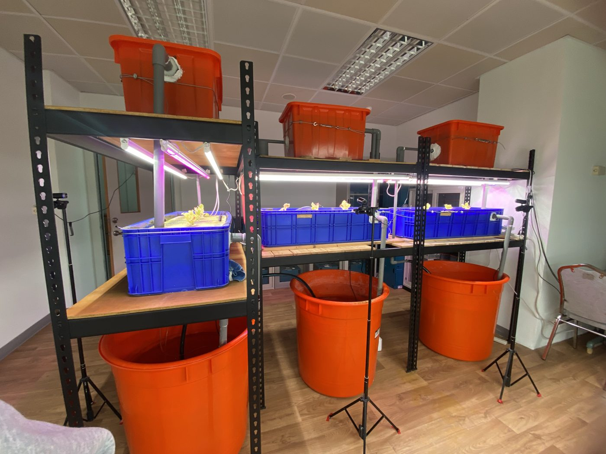
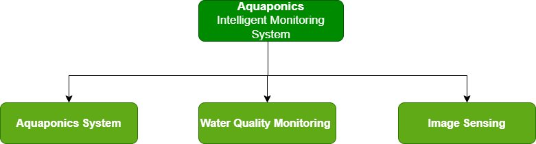
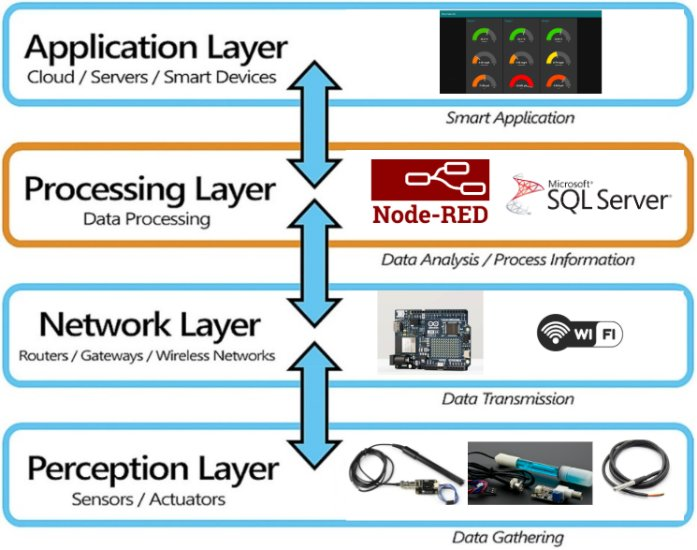
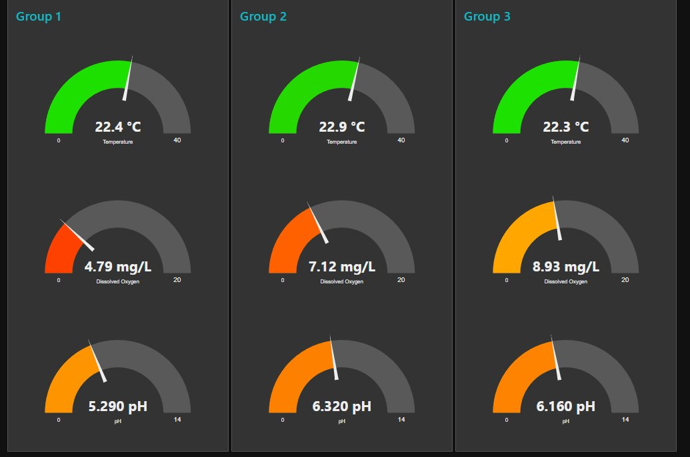
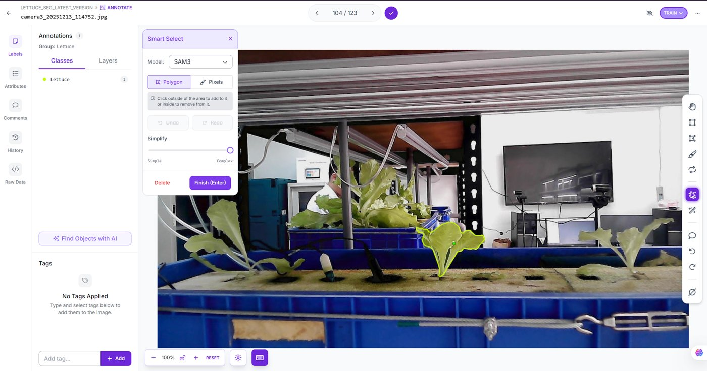
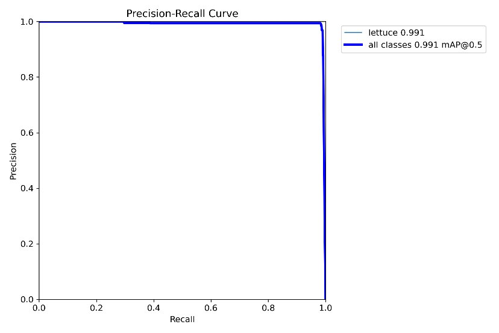
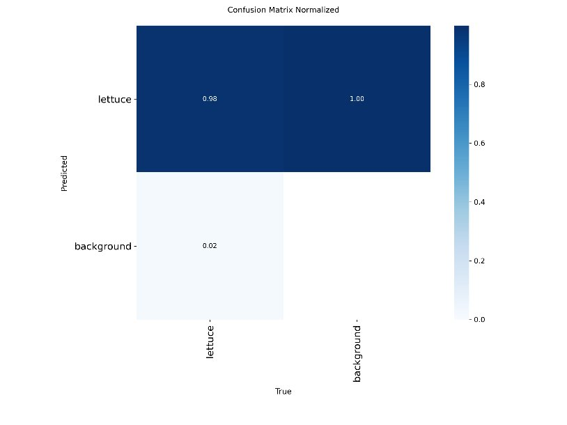
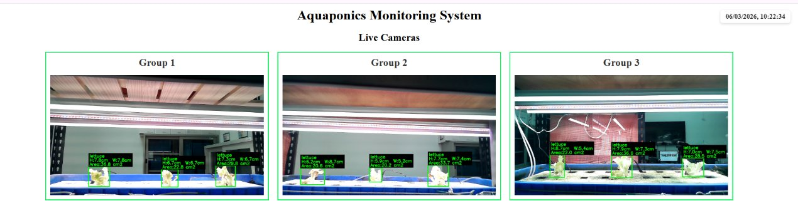
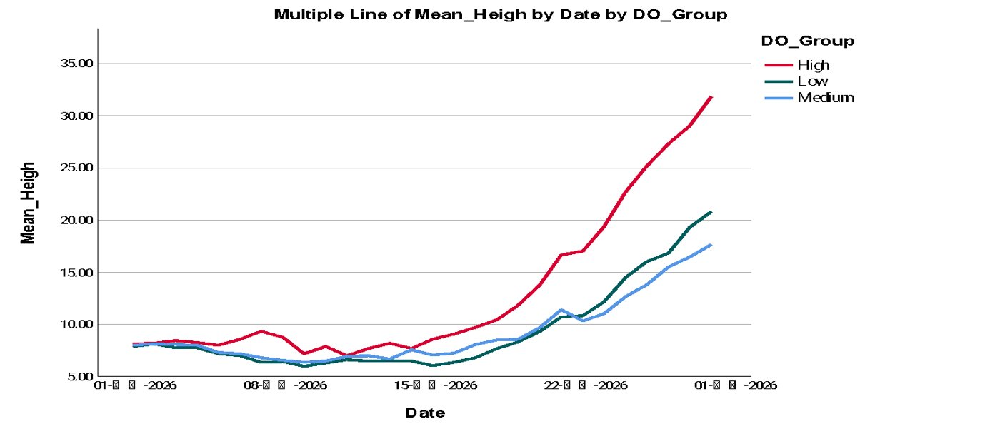
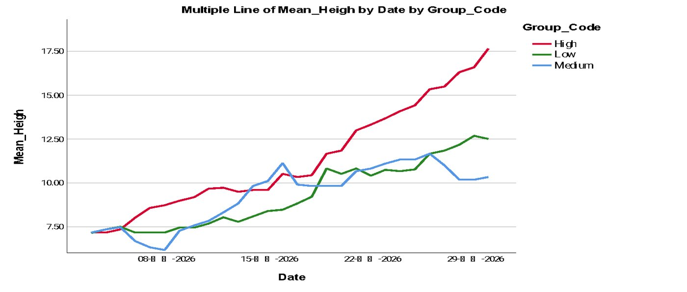

# AIoT Aquaponics Monitoring: Effect of Dissolved Oxygen on Lettuce Growth

An end-to-end **AIoT system** that monitors water quality with IoT sensors and measures plant growth with **computer vision (YOLOv8-seg)**, built for my Master's thesis at Tzu Chi University (Taiwan, 2026).

> **Thesis:** *AIoT-Enabled Monitoring System for Aquaponics: Impact of Dissolved Oxygen on Plant Growth via Computer Vision-Based Assessment*
> Jelisse Langa · M.Sc. Information Technology & Management, Tzu Chi University · Advisor: Dr. Lai Jhih-Ming · June 2026



## Highlights

- **Full IoT pipeline:** Arduino UNO R4 WiFi → MQTT → Node-RED dashboard → Microsoft SQL Server, running 24/7 for two 28-day experiments.
- **Computer vision:** YOLOv8s-seg instance segmentation of lettuce, **mAP@0.5 = 0.991**, trained on 1,473 images I annotated in Roboflow.
- **Automatic plant phenotyping:** canopy height, width and area measured from segmentation masks every 2 hours, without touching the plants.
- **Web monitoring system:** Flask dashboard showing live annotated camera images and measurements for each group.
- **Statistical analysis:** one-way ANOVA and Scheffé post-hoc tests (SPSS). High dissolved oxygen gave significantly taller lettuce in both rounds (p = 0.012 and p = 0.001).

## The experiment

Three independent **Deep-Water Culture (DWC)** aquaponics systems (210 L fish tank with tilapia, plant tank with lettuce on floating rafts, filter tank), identical except for dissolved oxygen (DO):

| Group | DO level | How DO was controlled |
|---|---|---|
| Low | < 5 mg/L | No aeration, reduced water flow |
| Medium | 5–8 mg/L | Low-power air pump + air stones |
| High | > 8 mg/L | High-power air pump + nano-bubble generator |

Two rounds were run: **1–28 Feb 2026** and **3–30 Mar 2026**.



## System architecture

The IoT side follows a four-layer architecture:

| Layer | Components |
|---|---|
| Perception | DFRobot Gravity DO sensor, pH sensor, DS18B20 waterproof temperature sensor |
| Network | Arduino UNO R4 WiFi publishing JSON over MQTT |
| Processing | Node-RED (flows, aggregation), Microsoft SQL Server (storage) |
| Application | Node-RED live dashboard; Flask plant-monitoring web app |



**Water quality:** readings every 30 minutes, 24 hours a day, stored in MSSQL. Daily representative values (09:00–17:00) are computed at 17:05 for analysis. Sensors were calibrated weekly and checked against manual measurements.



## Computer vision pipeline

1. **Image capture.** Full HD USB webcams in a fixed front view take images every 2 hours (09:00–17:00). LED grow lights are switched off about 5 minutes before each capture to reduce glare.
2. **Annotation.** Lettuce regions were labelled for instance segmentation in Roboflow. The dataset grew from 1,122 images (earlier lab experiments) to **1,473 images** after adding images from Round 1.
3. **Training.** YOLOv8s-seg (Ultralytics), pretrained weights, image size 960, up to 300 epochs, AdamW, lr 0.0008, weight decay 0.0005, early-stopping patience 30, seed 42. Plant-friendly augmentation: small rotation, translation, scaling, flips, HSV jitter; mosaic/mixup disabled to keep masks clean.
4. **Measurement.** Area = mask pixel count × cm² per pixel. Height and width come from the mask's extreme pixel coordinates, with a bounding-box fallback. Pixels are converted to cm using a per-camera calibration with a reference object at a fixed distance.



### Model performance

| Metric | Value |
|---|---|
| mAP@0.5 | **0.991** |
| Correct lettuce instances | 507 |
| False positives / false negatives | 5 / 8 |
| Normalised confusion matrix | ~98% correct |

<p>
  
  
</p>

The very high mAP partly reflects that training and test images come from the same controlled lab, so generalisation to other environments would need more diverse data.

### Flask monitoring system



## Results

| Growth parameter | Round 1 (Feb) | Round 2 (Mar) |
|---|---|---|
| Height | Significant, **p = 0.012**. High > Low (p = 0.039), High > Medium (p = 0.032) | Significant, **p = 0.001**. High > Low (p = 0.006), High > Medium (p = 0.006) |
| Width | Not significant (p = 0.744) | Not significant (p = 0.432) |
| Area | Not significant (p = 0.082) | Significant, **p = 0.027**. High > Medium (p = 0.039) |

<p>
  
  
</p>

**Conclusion:** high DO consistently produced taller lettuce, and the AIoT system ran reliably through both 28-day rounds, giving continuous, non-invasive growth data in place of manual measurements.

**Engineering lesson:** the DO and pH sensors interfered with each other when connected to the same Arduino board, which corrupted the pH readings. Separating them onto different input channels fixed the problem. Future versions should use better signal isolation or a dedicated microcontroller per sensor.

## Repository structure

```
firmware/
  do_calibration/        Arduino sketch: two-point DO sensor calibration (serial commands A / Z / P)
  do_temp_mqtt/          Arduino sketch: reads DO + water temperature, publishes JSON over MQTT every 5 s
vision/
  image_capture.py       Timed capture from two USB cameras (dataset collection)
  image_preprocessing.py Minimal, YOLO-safe preprocessing of Roboflow exports
  data_split.py          70 / 15 / 15 train / val / test split with labels
  train_yolov8_seg.py    YOLOv8s-seg training, validation and sample predictions
  data.yaml              Dataset config
dashboard/
  app.py                 Flask web app + scheduler (measures every group, saves to MSSQL every 3 h)
  plant_monitor.py       Camera capture, segmentation, height / width / area measurement
  database_manager.py    MSSQL table creation and inserts
  templates/index.html   Dashboard page
docs/images/             Figures from the thesis and lab photos
```

## Running it

**Firmware** (Arduino IDE, board: Arduino UNO R4 WiFi; libraries: ArduinoMqttClient, OneWire, DallasTemperature)

1. Upload `do_calibration`, open the Serial Monitor at 115200 baud, press `A` (air) and optionally `Z` (zero solution), then `P` to print the calibration values.
2. Paste the values into `do_temp_mqtt.ino`.
3. Copy `arduino_secrets.example.h` to `arduino_secrets.h`, add your Wi-Fi and MQTT details, and upload.

**Model training**

```bash
cd vision
pip install -r requirements.txt
python image_preprocessing.py   # expects Roboflow export in from_lab_labeled/
python data_split.py
python train_yolov8_seg.py
```

**Dashboard**

```bash
cd dashboard
pip install -r requirements.txt
export MODEL_PATH=path/to/best.pt
export MSSQL_SERVER=... MSSQL_DATABASE=... MSSQL_USERNAME=... MSSQL_PASSWORD=...
python app.py                   # open http://127.0.0.1:5000
```

Set the camera index and the pixels-per-cm calibration for each group in `plant_monitor.py`.

## Not included

- **Dataset and trained weights.** Part of the dataset came from earlier student experiments in the lab, so only results are published here.
- **Node-RED flow and the pH sensor sketch.** These ran in the lab setup but are not part of this repository.

## Publication

J. Langa, J.-M. Lai, S.-T. Ciou. *A Preliminary Study on Using AI Technology in Smart Agriculture.* Oral presentation, 19th International Conference on Innovation, Management and Knowledge Community (iCIMKC 2025), 18 May 2025.

## Tech stack

`Arduino (C++)` · `MQTT` · `Node-RED` · `Microsoft SQL Server` · `Python` · `Ultralytics YOLOv8-seg` · `PyTorch` · `OpenCV` · `Roboflow` · `Flask` · `IBM SPSS`
